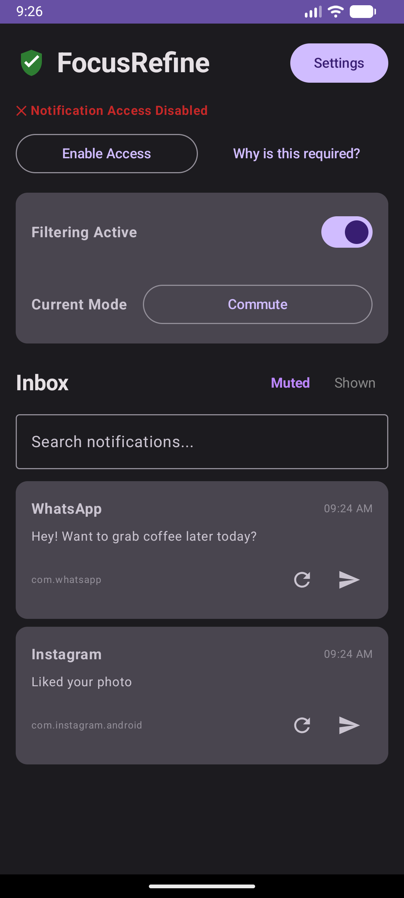
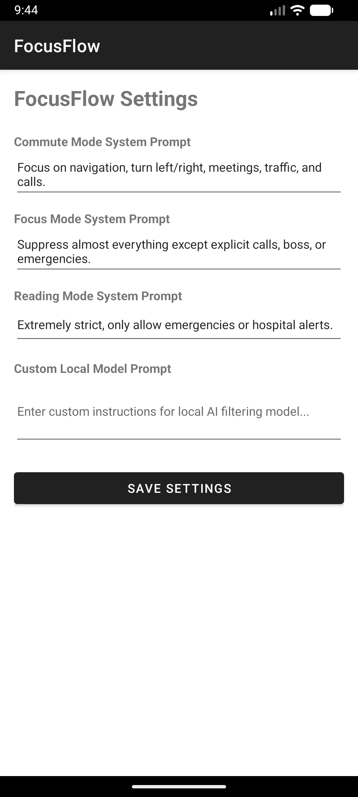

# FocusFlow

**FocusFlow** is a modern, lightweight, privacy-focused Android application designed to intelligently filter and triage incoming notifications based on your current activity mode (Commute, Focus, Reading, and custom modes).

---

## Why This Was Built

In an era of relentless notification spam (promotional alerts, social media pings, group chats), staying focused during deep work, driving, or reading is difficult. Traditional Do Not Disturb modes are often all-or-nothing and cause you to miss critical alerts. 

**FocusFlow** solves this by:
1. **Analyzing content locally on-device** using context-aware heuristics and on-device models.
2. **Reading urgent notifications aloud** via Text-To-Speech (TTS) if they match your active mode criteria (e.g. navigation updates, work meetings, emergencies).
3. **Silently archiving non-urgent notifications** into a local Room database inbox so they are out of sight, yet accessible whenever you want.

---

## Key Functionality & UI Walkthrough

### 1. Main Dashboard & Master Control
- **START / STOP Master Switch**: Instantly toggle notification filtering on or off. When stopped, notifications pass through normally.
- **Context Modes**: Switch between **Commute**, **Focus**, **Reading**, and your own **Custom Modes** to adjust filtering strictness.
- **Dynamic Notification Access**: Automatically detects notification access permissions, hiding the setup button and displaying a green checkmark once granted.
- **Muted vs. Shown Tabs**: Switch between **Muted (Archived)** notifications and **Shown (Urgent)** notifications.

  

---

### 2. Configuration & Custom Prompt Settings
- **System Prompts & Toggles**: View, edit, enable, or disable out-of-the-box system instructions for Commute, Focus, and Reading modes.
- **Custom Modes Management**: Create one or more custom modes with dedicated custom prompts.
- **Local Model Prompt Integration**: Fine-tune natural language classification rules on-device.

  

---

## Technical Implementation Overview

1. **Notification Interception (`NotificationFilterService`)**:
   - Extends `NotificationListenerService` to intercept system-wide `StatusBarNotification` events in real-time.
   - Evaluates whether filtering is active (`service_running` in `SharedPreferences`) and analyzes notification content against the active mode prompt.
   - If urgent (`isUrgent = true`), speaks aloud via `TextToSpeech` and stores the record in Room DB with `isUrgent = true`.
   - If non-urgent, cancels/dismisses the notification from the system tray and stores the record in Room DB with `isUrgent = false`.

2. **Local Persistence (`Room Database`)**:
   - `NotificationEntity` stores notification metadata (`title`, `text`, `packageName`, `timestamp`, `isUrgent`).
   - `NotificationDao` provides asynchronous queries (`getAll()`, `getByUrgency()`).

3. **Hyper-Minimalist UI & Theme Adaptability**:
   - Built with Material Components DayNight theme (`Theme.Material3.DayNight.NoActionBar`).
   - Digital minimalism design principles: ample whitespace, high-contrast typography, flat hierarchy, and seamless Light/Dark mode compatibility (`minSdk = 28`+).
