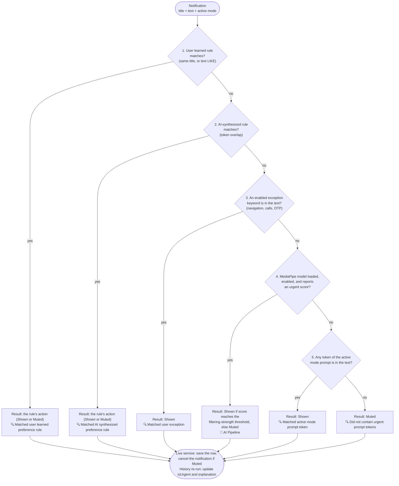

# FocusRefine — AI Classification Architecture, Modes, Exceptions & AI Prompt Synthesis

This document defines out-of-the-box filtering modes, system prompts, filtering strength thresholds, JSON-driven pre-configured exceptions, AI prompt synthesis learning, and the integration of **Google AI Edge MediaPipe Tasks Text Classification** in **FocusRefine**.

---

## 1. Out-of-the-Box Modes & System Prompts

FocusRefine includes dynamic context modes. By default, **Commute** and **Deep Focus** are enabled on the Home screen, while other modes can be toggled on/off in Context Modes settings:

### Commute Mode (Enabled by Default)
- **System Prompt / Heuristic**: `"navigation, maps, turn left, turn right, traffic, call, vip, boss, route"`
- **Behavior**:
  - **Shown**: Real-time navigation prompts (Google Maps, Waze), incoming phone calls, calendar meeting reminders, and traffic hazard alerts.
  - **Muted**: Social media pings, promotional offers, news updates, casual chat messages.

### Deep Focus Mode (Enabled by Default)
- **System Prompt / Heuristic**: `"urgent, call, boss, meeting, build, outage, deadline"`
- **Behavior**:
  - **Shown**: Incoming phone calls, VIP contacts (e.g. "boss"), manager escalations, critical build/deploy failures.
  - **Muted**: Email newsletters, social updates, casual chat messages.

### Sleep Mode
- **System Prompt / Heuristic**: `"emergency, family, hospital, call, alarm"`
- **Behavior**:
  - **Shown**: Emergency alerts, family calls, hospital updates, critical alarms.
  - **Muted**: All routine alerts, social apps, emails, non-urgent pings.

### Gaming Mode
- **System Prompt / Heuristic**: `"call, priority, emergency"`
- **Behavior**:
  - **Shown**: Priority calls and emergency alerts.
  - **Muted**: Routine emails, social chats, non-urgent alerts.

---

## 2. Filtering Strength Control (`SettingsActivity.kt`)

FocusRefine allows users to tune filtering strictness via a tri-state segmented control:

| Filtering Strength | Score Threshold | Behavior |
| :--- | :--- | :--- |
| **Gentle (`0`)** | `score >= 0.4f` | Lenient filtering. Allows lower confidence AI predictions and loose keyword matches to pass through as Shown. |
| **Balanced (`1`)** | `score >= 0.6f` | Default balanced filtering. Standard AI confidence and mode prompt matching. |
| **Strict (`2`)** | `score >= 0.8f` | High suppression. Requires high AI confidence or exact VIP/emergency rules to pass as Shown. Aggressively mutes routine pings. |

---

## 3. JSON-Driven Pre-Configured Exceptions (`assets/exceptions.json`)

Pre-configured exceptions are externalized into `assets/exceptions.json` and parsed by `ExceptionManager.kt`:

```json
[
  {
    "id": "nav_prompts",
    "title": "Navigation prompts",
    "description": "Directions while you're on the move",
    "icon": "🚀",
    "prefKey": "exception_nav_prompts",
    "defaultEnabled": true,
    "keywords": ["navigation", "maps", "turn left", "turn right", "traffic", "route", "200 feet", "merge"]
  },
  {
    "id": "calls_priority",
    "title": "Calls & priority contacts",
    "description": "Let important people reach you",
    "icon": "📞",
    "prefKey": "exception_calls",
    "defaultEnabled": true,
    "keywords": ["call", "incoming call", "missed call", "mom", "dad", "wife", "husband", "boss", "emergency"]
  },
  {
    "id": "security_otps",
    "title": "Security & OTP verifications",
    "description": "Two-factor auth codes and bank security pings",
    "icon": "🔐",
    "prefKey": "exception_security_otps",
    "defaultEnabled": true,
    "keywords": ["otp", "verification code", "security", "bank", "authentication", "login code", "passcode"]
  }
]
```

---

## 4. MediaPipe AI Pipeline vs. Semantic Search Inputs

The decision logic lives in `NotificationClassifier` (shared by the live listener service and the history re-run). It distinguishes the **MediaPipe On-Device AI Pipeline** from **Semantic Search / Prompt Matcher** inputs. The order below is the real precedence: the first step that matches decides.



The first step that matches decides, so a learned rule always beats an exception, and an exception always beats the model. The model is only consulted at step 4 (and its inference is skipped entirely when an earlier step already decided). Step 5 never falls through: it always returns Shown or Muted. Thresholds for step 4 follow the filtering-strength setting (`Gentle` 0.4, `Balanced` 0.6, `Strict` 0.8).

1. **`🤖 [AI Pipeline]`**: On-device MediaPipe `TextClassifier` (`text_classifier.tflite`). When it produces an `urgent` score it generates explicit explanations for both Urgent (*Shown*) and Routine (*Muted*) classifications:
   - Urgent AI Explanation: `🤖 [AI Pipeline] MediaPipe model classified notification as urgent with 88% confidence (exceeded Deep Focus threshold 60%).`
   - Routine AI Explanation: `🤖 [AI Pipeline] MediaPipe model confidence 35% was below Deep Focus urgency threshold (60%); muted as routine.`
   - **Availability:** the model file is **not in the repository**, so model creation fails and the pipeline falls back to semantic search on every device, real phones included (verified on a Pixel 9 Pro XL: the native library loads, then MediaPipe fails to open the missing asset). MediaPipe's public text classifiers are sentiment models (`positive` / `negative`) and never produce an `urgent` category, so they cannot drive this step; a custom-trained model would be needed.
2. **`🔍 [Semantic Search]`**: Token-based keyword matching, user exception rules, and dynamic AI-synthesized preference rules. In practice this is the engine that decides today.

Keep the explanation prefixes (`🤖 [AI Pipeline]`, `🔍 [Semantic Search]`) stable: they are persisted, shown in the detail screen, and referenced by tests and docs.

---

## 5. AI-Driven Dynamic Prompt Synthesis (`AiRuleSynthesizer.kt`)

When a user reclassifies a notification (e.g., clicking *"Show notifications like these in the future"* or *"Hide notifications like these in the future"*):

1. **Dynamic Token Extraction**: `AiRuleSynthesizer` extracts significant semantic tokens from title and body text without hardcoded keyword or app rules.
2. **Rule Synthesis**: Generates a dynamic, human-readable rule string (e.g., `"[MUTE] Whatsapp: grab coffee later"` or `"[ALLOW] Jenkins: build failed main"`).
3. **Dynamic Token Overlap Matching (`matchesRule`)**: Future incoming notifications are matched against synthesized rules using dynamic token overlap ratios.
4. **Opposite Classification Adaptation**: When a user reclassifies a notification that was originally classified as Muted, the synthesized rule flips subsequent similar notifications to **Shown** (and vice-versa).

---

## 6. Re-running Classification on History

Settings → **Learning & Feedback** → **Re-run classification on history** re-evaluates every stored notification (`HistoryReclassifier`). It is useful after changing the mode, filtering strength, exceptions, or learned rules.

- Uses the **current** mode for all history, not the mode that was active when each notification arrived.
- Rows may move between *Shown* and *Muted* and get a fresh explanation. Learned-rule rows are never changed.
- Only the in-app inbox changes. Muted notifications were already cancelled from the system shade when they arrived and are not restored; nothing is added to or removed from the shade.
- A confirmation dialog is shown first, a spinner while it runs, and a toast reports the result (for example `Re-classified 25: 6 now Shown, 1 now Muted`).

---

## 7. Measured Quality & Embedding Classifier Findings

A labeled dataset (`testdata/golden/`) and an adb end-to-end replay (`scripts/replay_golden.py`) measure the real service on an emulator or device. See [Technical Implementation Guide](internals.md#3-testing--evaluation) for how to run them.

**Current production engine** (keyword fallback, macro average over the five OOTB modes): golden set F1 **0.40**, held-out set F1 **0.36**. The main causes, all measured:
- **Exceptions fire on the whole text, including app names.** "Calls & priority contacts" Shows `Mom | Good morning!` and `Boss | Thanks, noted`; "Navigation prompts" Shows `Google Maps | Rate your visit`; "Security & OTP" Shows a bank statement. Some of this is intended (these exceptions apply in every mode), but it disagrees with mode-specific expectations.
- **Substring tokens.** Prompt tokens such as `or` and `and` match inside unrelated words.
- **`Workout / Gym` has no dedicated branch** in the keyword lookup, so it falls back to a generic default prompt (F1 0.11).
- **Paraphrases are missed**: every false negative is "no keyword matched".

**TextEmbedder prototype (findings from a throwaway spike; not part of this codebase).** An embedding classifier scores each mode as the best similarity to example phrases for that mode minus the best similarity to "routine" anchors. Unlike the sentiment classifiers it works with the modes and prompts the user edits, runs in the background on any API 28+ device, and needs no training. Results with thresholds tuned on the golden set only:

| | Golden F1 | Held-out F1 |
| :--- | :--- | :--- |
| Keyword engine (benchmark re-implementation) | 0.42 | 0.35 |
| Embedding, similarity to mode prompt only | 0.61 | 0.44 |
| Embedding, examples minus routine anchors | 0.77 | 0.60 |

Cost on a Pixel 9 Pro XL: about 40 ms per notification (p95 about 90 ms), about 6 MB of native heap, and a 6.1 MB model (MediaPipe's Universal Sentence Encoder). The model's redistribution terms were not reviewed, and it would add its size to every APK, so it is not bundled here. The weakest mode is Deep Work / Focus (short technical alerts), and real emergencies need shared anchors in every mode. The dataset and anchor phrases are synthetic, so treat these figures as indicative.
