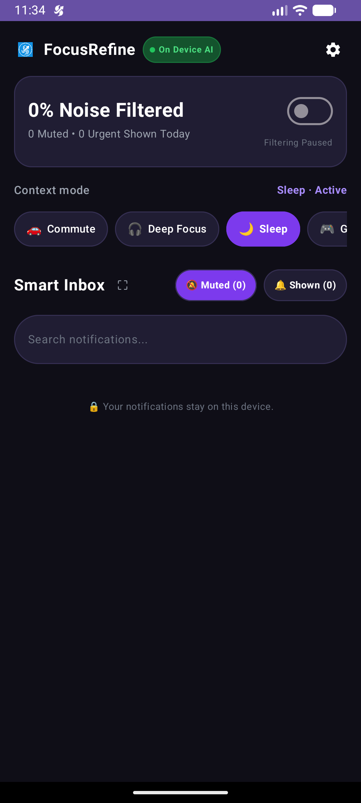
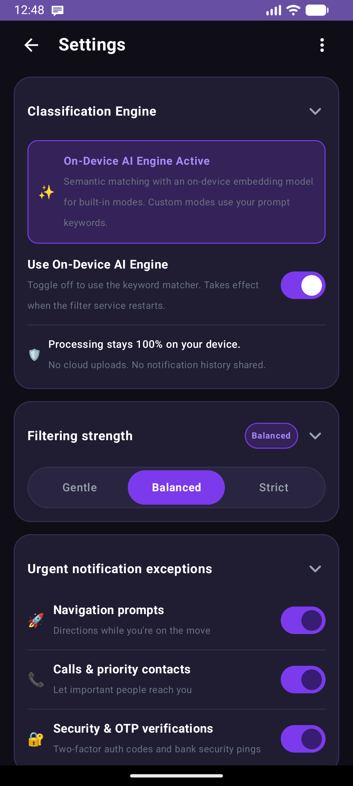
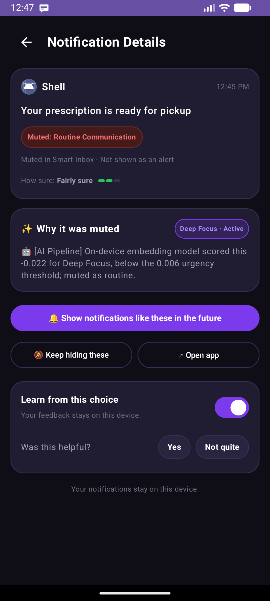
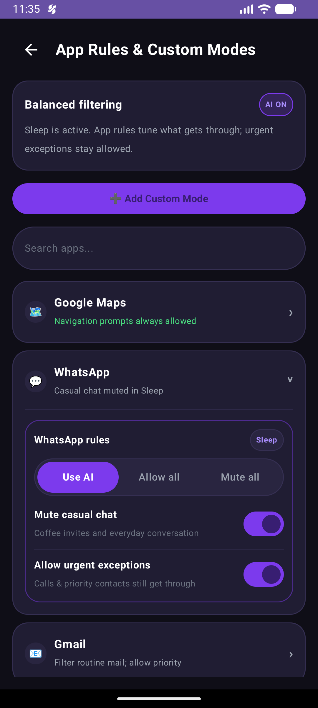
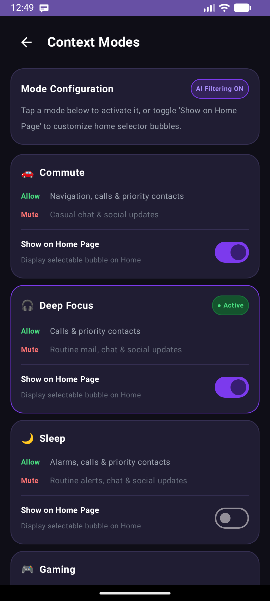
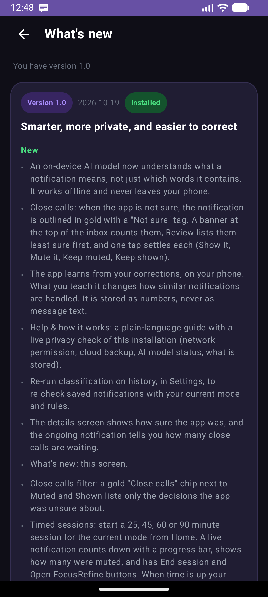
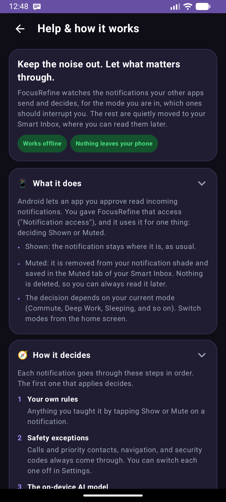
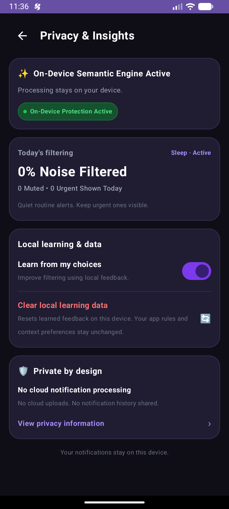

# FocusRefine — Feature Walkthrough & Demo Guide

This document provides a feature walkthrough and visual demonstration guide for **FocusRefine** across its 6 Dark Studio screens.

---

## 🎬 Screen-by-Screen Feature Walkthrough

### 1. Main Dashboard & Smart Inbox (`MainActivity.kt`)

- **Top Bar**: Displays the app logo, `FocusRefine` header with the `● On Device AI` green badge beside it (under it on narrow screens), and the Help and Settings buttons in a single row.
- **Noise Filter Stat Banner Card**: Displays dynamic noise filtered percentage (e.g., `84% Noise Filtered`) and live counters (`42 Muted • 8 Urgent Shown Today`).
- **Search**: the search bar is hidden until you tap the magnifier (🔍) beside the Smart Inbox title, which keeps the list near the top.
- **Mode line**: the mode is a line in the status card on Home (for example `Commute`, or the mode you last chose). Tap it to see what each mode lets through and switch modes; **Edit modes and prompts** opens `ContextModesActivity`.
- **Smart Inbox Tabs, Swipe Gesture & Animations**: Toggle between `🔕 Muted` and `🔔 Shown` pill tabs or **swipe left / right** across the notification list to switch tabs with smooth Compose spring slide animations.
- **Native App Icon Cards**: Displays authentic native app icons (`AppIconImage`) for installed applications.
- **Close calls**: a gold "Close calls (2)" chip next to the tabs counts decisions the app was not sure about; tapping it lists them least sure first. Each has a "Not sure" pill and one-tap **Show it / Mute it** and **Keep muted / Keep shown** buttons. See [Close calls](inbox_review.md).
- **Full-Screen Smart Inbox (`⛶`)**: Tapping the full-screen icon expands the Smart Inbox into a full-height dialog view.

---

### 2. Settings Screen (`SettingsActivity.kt`)

- **Collapsible Studio Cards**: All cards are collapsible (open/expanded by default) with clickable headers and expand/collapse chevrons (`˅` / `›`).
- **Classification Engine Toggle**: Switch between `On-Device AI Engine Active` (on-device Track B model) and `On-Device Keyword Matcher Active`. The banner reflects the engine that actually loaded.
- **Filtering Strength**: Tri-state segmented control (`Gentle` | `Balanced` | `Strict`) shifting the AI urgency thresholds.
- **Urgent Notification Exceptions**: JSON-driven switches for `Navigation prompts`, `Calls & priority contacts`, and `Security & OTP verifications` loaded from `assets/exceptions.json`.
- **Advanced Settings**: Includes an **"Inbox Swipe Animations"** toggle to enable or disable horizontal slide transitions on Smart Inbox tab switches.
- **Learned Rules Direct Access**: Dedicated navigation link to view and manage AI-synthesized learned rules in `LearnedRulesActivity`.
- **Re-run Classification on History**: In the *Learning* card, tap **"Re-run classification on history"** and confirm the dialog to re-check every stored notification with the current mode, filtering strength, exceptions and learned rules. A spinner shows while it runs and a toast summarizes the result (e.g. `Re-classified 25: 6 now Shown, 1 now Muted`). Learned rules are never changed, and the notification shade is untouched. Try it after switching modes or adding a learned rule.
- **Sample Seeding & Clear Inbox**: Tap **"✨ Add 20 Samples"** to seed 20 pre-configured test notifications or **"🗑 Clear Inbox"** to purge history.

---

### 3. Notification Details (`NotificationDetailActivity.kt`)

- **Inspection Card**: Displays native app icon, content text, timestamp, and status badge (`Muted: Routine Communication` / `High Urgency: Priority Prompt`).
- **AI Explanation Card**: Displays why the notification was muted or shown, clearly highlighting **`🤖 [AI Pipeline]`** (Track B model score vs threshold) vs **`🔍 [Semantic Search]`** evaluation reasons.
- **Dynamic Preference Action Buttons**:
  - When notification is hidden: `"🔔 Show notifications like these in the future"` (Secondary: `"🔕 Keep hiding these"`).
  - When notification is shown: `"🔕 Hide notifications like these in the future"` (Secondary: `"🔔 Keep showing these"`).
- **Feedback Controls**: Record user feedback (*"Was this helpful?"* -> `Yes` | `Not quite`).

---

### 4. App Rules (`ConfigureModesActivity.kt`)

- **App Search Bar**: Real-time search filter across installed and preset apps.
- **Expandable Rule Drawer**: Tapping an app expands an embedded rule tuner with segmented control (`Use AI` | `Allow all` | `Mute all`), `Mute casual chat` toggle, and `Allow urgent exceptions` toggle. Purely focused on per-app rules.

---

### 5. Context Modes (`ContextModesActivity.kt`)

- **Active Mode Banner**: Displays `Commute · Active` status.
- **Show-on-Home Toggles**: Each context mode card features a *"Show on Home Page"* toggle controlling which mode bubbles appear on the Home screen.
- **Mode Cards Breakdown**: Displays Allow/Mute rule summaries for `Commute`, `Deep Focus`, `Sleep`, `Gaming`, and custom modes.
- **Add Custom Context Mode**: Create and manage custom mode definitions and natural language prompt rules.

---

### 8. What's new (`ChangelogActivity.kt`)

- Opened from the **⋮ menu** in the Settings top bar. Release notes, newest first, grouped as New, Improved, Fixed and Privacy, with the installed version marked. The text lives in `assets/changelog.json`. See [Help screen](help_screen.md).

---

### 7. Help & how it works (`HelpActivity.kt`)

- Opened from the **?** button on the home screen or from the **⋮ menu** in Settings. Plain-language sections on what the app does, how it decides, how to teach it, what it cannot do well, what is stored, and troubleshooting. Its **Offline-first and private** section includes a live privacy check of the installed app (no network permission, cloud backup off, AI model status, what is stored). See [Help screen](help_screen.md).

---

### 6. Privacy & Insights (`PrivacyInsightsActivity.kt`)

- **Protection Badge**: Displays `● On-Device Protection Active`.
- **Today's Filtering Stats**: Displays `84% Noise Filtered` metrics.
- **Local Learning & Data**: Toggle local feedback learning or reset learned feedback rules.
- **Private by Design Card**: Located at the bottom of the screen, guaranteeing no notification data is ever uploaded or processed in the cloud.
