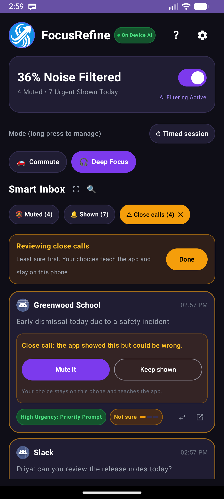
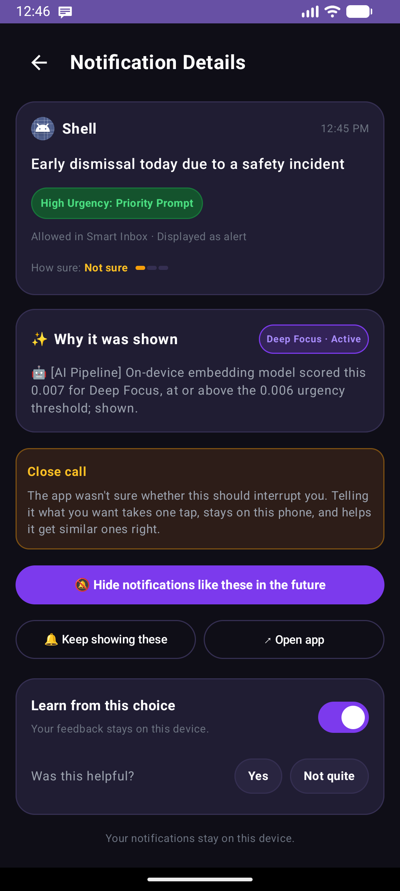

# Close calls: helping users decide and correct

The app now says when it is not sure, and makes a correction a single tap. Everything stays on the phone.

## What the user sees
- **A gold "Close calls (N)" chip** next to the Muted and Shown tabs counts the decisions the app was not sure about. Tapping it lists only those, across the Shown and Muted tabs, least sure first, under a slim "Reviewing close calls" banner. **Done** (or the chip again) returns to the normal tabs; the chip disappears when nothing is left. There is no banner while you are not reviewing, so the list stays near the top of the screen.
- **A close-call card** has an amber outline, a "Not sure" pill with a small three-bar meter, and a box that says whether the app muted or showed it and could be wrong. Two buttons settle it without opening the details: **Show it** / **Mute it** (flip the decision) and **Keep muted** / **Keep shown** (confirm it). Both are lessons: the app learns from either.
- **A "Close calls (N)" chip** sits next to the Muted and Shown tabs (also in the full-screen inbox) whenever something needs review. One tap filters the list to close calls; tap it again, or pick a tab, to go back. It combines with search.
- **The detail screen** shows "How sure: Not sure" with the meter and a "Close call" note: telling the app what you want takes one tap, stays on this phone, and helps it get similar ones right. After a choice it says "You decided this one."

- **The ongoing notification** in the shade reads, for example, "Suppressed: 12 notifications · 2 close calls to review".
- The swap icon on every card and the buttons on the detail screen use the same code path, so every correction also teaches the on-device personal model (see [`personal_model.md`](personal_model.md)). Before this change the swap icon did not.

## What counts as a close call
Each decision stores a confidence: `sigmoid(|z|)`, where `z = 60 x (score - threshold) + personal adjustment` is the distance of the embedding score from the line between Shown and Muted. It runs from 0.5 (right on the line) to 1.0. Below **0.75** (about one filtering-strength step, 0.02 of score, from the threshold) the decision is flagged; 0.90 and above is "Very sure". It is a distance, not a calibrated probability, so the UI uses words and a meter, not percentages.
- Rules, exceptions and the user's own choices are certain (1.0) and never flagged.
- Keyword matching (custom modes, or the AI engine off) records no confidence, so it is never flagged. Re-run classification on history recomputes it.
- A row the user has corrected (a learned rule) is no longer a close call.

## Storage
`NotificationEntity.confidence` (nullable `REAL`) was added with a proper Room migration 5 to 6 (`ALTER TABLE ... ADD COLUMN`), so existing history and learned rules survive; the destructive fallback would have erased them. `NotificationDao.getUncertain` and `countUncertain` back the review list and the banner. The count is mirrored in the preference `uncertain_count` so the ongoing notification can show it without a database query on the main thread (`ReviewQueue`).

## How well it works: an honest limit
A flag can only catch a decision that is *near* the line. Measured on the 1,209-item corpus, embedding model alone (760 safety notifications that should be Shown, one per mode they matter in): the model shows 39% of them at Balanced and misses 61%. Of the 465 misses, only 150 (32%) are close enough to the line to be flagged for review; the rest are muted with high confidence and would not be surfaced. Strict filtering (+0.02) would also mute 157 of the 295 that Balanced shows (53%), because many safety alerts score just above the threshold. So the review list helps with borderline cases; it does not replace fixing the model's blind spots (see [`model_coverage_gaps.md`](model_coverage_gaps.md)).

## Tests
- `ConfidenceTest` (JVM): the confidence function and the flag rules.
- `ConfidenceStorageTest` (device): upgrading from a version-5 database keeps history and learned rules; review queries; reclassifying updates the confidence; a user's choice makes a decision certain and teaches the personal model, or only stores it when learning is off.
- `InboxReviewE2ETest` (device): the banner, the pill, Review, "Show it" and "Keep muted" through the real inbox, checking the database, the confidence and the personal model.
- `PipelineE2ETest` (device, real listener service): mode changes the decision; filtering strength moves a borderline decision; clear cases are confident and a close call is flagged; the ongoing notification counts close calls; muted notifications leave the shade and shown ones stay; a stopped service leaves notifications alone; the calls exception can be switched off; a custom mode uses the user's own keywords; a learned rule beats the model and is certain; the Stop button toggles filtering.
- `ScreensE2ETest` (device): re-running classification from Settings, clearing learning data from the Privacy screen, and deleting a learned rule (which also forgets the lesson).
- `AccessibilityDriver` and `ServiceHarness` are the shared helpers (the Compose test rule needs Espresso, which does not run on the newest emulator images).

## Ideas not done
Sorting the Muted tab by confidence; a weekly "things you might have missed" digest; a setting to change the flag threshold; surfacing close calls as a (silent) notification; raising the flag threshold for safety-like text. The last one matters most, given the limit above.
