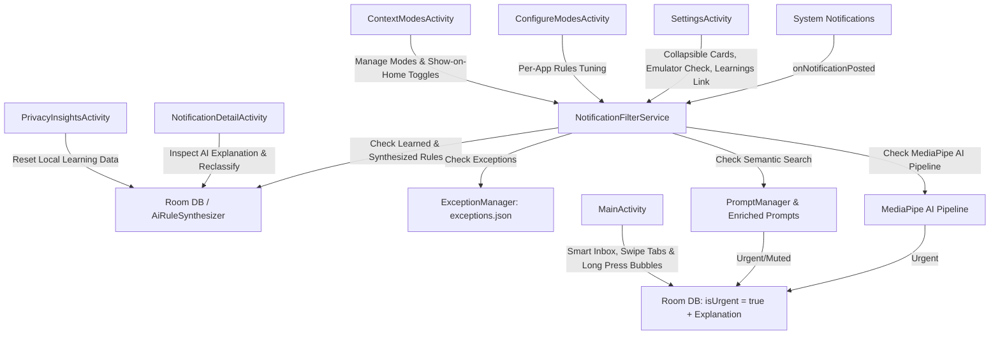

# FocusRefine — Technical Implementation Guide & Architecture

This document provides a comprehensive technical breakdown of the architecture, data flows, core services, persistence layers, and 16 KB memory page size alignment in **FocusRefine**.

---

## 1. Architecture & Component Interaction



---

## 2. Core Technical Components

### A. Background Notification Filtering (`NotificationFilterService`)
- **Lifecycle**: Persistent Android Foreground Service (`specialUse`) implementing `NotificationListenerService`.
- **Pipeline Order**:
  1. **User Learned & AI Synthesized Rules**: Evaluates exact title/text overrides and dynamic token rules from `AiRuleSynthesizer.matchesRule()`.
  2. **JSON-Driven Exceptions**: Evaluates user-enabled exception rules from `ExceptionManager.getAllExceptions(this)` (`assets/exceptions.json`).
  3. **MediaPipe AI Pipeline (`🤖 [AI Pipeline]`)**: Evaluates `text_classifier.tflite` against dynamic filtering strength thresholds (`Gentle` = `0.4f`, `Balanced` = `0.6f`, `Strict` = `0.8f`). Automatically disabled on emulator environments where JNI native library is absent.
  4. **Semantic Prompt Search (`🔍 [Semantic Search]`)**: Tokenizes content against active mode prompts enriched with synthesized rules (`PromptManager`).
- **Classification Result Output**: Generates both Recommended Action (`isUrgent`) and Explanation text stored in `NotificationEntity`.

### B. Dark Studio Design System & Reusable UI Components
- **`FocusRefineTheme`**: Defines `#0F0E17` dark background, `#181625` / `#201D33` elevated surfaces, `#8B5CF6` electric violet primary accents, `#22C55E` green active badges, and `#EF4444` muted tags.
- **`StudioCard`**: Rounded container (`20.dp` corners) defaulting to `Modifier.fillMaxWidth()` with `#352F52` borders.
- **`AppIconImage`**: Renders native application icons directly from installed package manifests via `PackageManager`.
- **`StudioSegmentedControl`**: Horizontal tri-state and multi-option pill selector.
- **`StudioFooter`**: Scroll-triggered footer embedded inside containers.

### C. 6 Primary Screen Activities
1. **`MainActivity.kt`**: Smart Inbox dashboard with stat card, home context mode bubbles (enabled modes only, long press opens `ContextModesActivity`), search field, horizontal swipe gesture to toggle `Muted` / `Shown` tabs, and full-screen inbox dialog (`⛶`). Automatically refreshes notification access warning card on return from settings (`onResume`).
2. **`SettingsActivity.kt`**: Collapsible studio cards (open/expanded by default), emulator detection fallback, filtering strength selector (`Gentle` | `Balanced` | `Strict`), JSON-driven exception toggles, context mode switcher, and direct navigation links to **Learned Rules** (`Learnings`).
3. **`NotificationDetailActivity.kt`**: Notification inspection card, AI explanation card (*"Why it was muted/shown"*), updated preference action buttons (*"🔔 Show notifications like these in the future"* / *"🔕 Hide notifications like these in the future"*), and feedback controls.
4. **`ConfigureModesActivity.kt`**: Per-app rules list (`Google Maps`, `WhatsApp`, `Gmail`, `Instagram`) with expandable WhatsApp rule tuner drawer (`Use AI` | `Allow all` | `Mute all`). Purely focused on App Rules.
5. **`ContextModesActivity.kt`**: Context modes management hub. Allows adding custom context modes, editing natural language prompt rules, and setting *"Show on Home Page"* toggles for each mode.
6. **`PrivacyInsightsActivity.kt`**: On-Device protection status badge, daily filtering metrics card with dynamic `0% Noise Filtered` reset, and clear local learning data reset dialog.

### D. 16 KB Page Size Alignment (Android 15 Compatibility)
- Configured in `app/build.gradle.kts`:
  ```kotlin
  packaging {
      jniLibs {
          useLegacyPackaging = false
      }
  }
  ```
- Unsets `android:extractNativeLibs="true"` in `AndroidManifest.xml`, ensuring native JNI libraries (MediaPipe/TFLite) are aligned on 16 KB page boundaries in APK releases.

### E. Externalized Configuration Assets
- `assets/prompts.json`: Managed via `PromptManager.kt`.
- `assets/exceptions.json`: Managed via `ExceptionManager.kt`.
- `assets/samples.json`: 20 pre-configured test notifications for instant offline benchmarking and UI evaluation.
