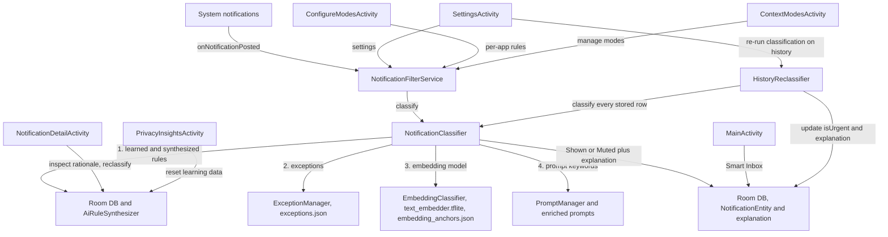

# FocusRefine — Technical Implementation Guide & Architecture

This document provides a comprehensive technical breakdown of the architecture, data flows, core services, persistence layers, and 16 KB memory page size alignment in **FocusRefine**.

---

## 1. Architecture & Component Interaction



---

## 2. Core Technical Components

### A. Background Notification Filtering (`NotificationFilterService`)
- **Lifecycle**: Persistent Android Foreground Service (`specialUse`) implementing `NotificationListenerService`.
- **Interruption Filter Safety**: Ensures system Do Not Disturb mode is **always restored to normal (`INTERRUPTION_FILTER_ALL`)** whenever service filtering is paused, stopped, or destroyed (`onDestroy`), preventing devices from being stuck in DND mode.
- **Delegation**: The service no longer contains the decision logic. On `onCreate` it loads the (optional) embedding model via `EmbeddingClassifier.create(this)`, starts a background warm-up of its anchors, and builds a `NotificationClassifier`; `onNotificationPosted` calls `classifier.classify(title, text, currentMode)`, then persists the result and cancels Muted notifications.

### B. Classification Engine (`NotificationClassifier.kt`)
`NotificationClassifier(context, database, embeddingClassifier?)` owns the Shown/Muted decision and is shared by the live service and the history re-run (section C), so both always agree. `classify()` returns a top-level `ClassificationResult(isUrgent, explanation)`.

**Decision precedence (first match wins; see the [flowchart](ai_classification_and_modes.md#4-mediapipe-ai-pipeline-vs-semantic-search-inputs)):**
1. **User learned rules** (`NotificationDao.findMatchingLearnedRule`) and **AI-synthesized rules** (`AiRuleSynthesizer.matchesRule()`).
2. **JSON-driven exceptions** from `assets/exceptions.json` (`ExceptionManager`), each gated by its SharedPreferences key.
3. **On-device embedding model** (`EmbeddingClassifier`), if it loaded, `use_ai_model` is on, and the active mode is a built-in one. It is only consulted at this step (skipped when a rule or exception already decided). Score = best cosine similarity to the mode's example phrases minus best similarity to routine phrases; Shown when the score reaches the mode's threshold. Examples, routine phrases and per-mode thresholds are in `assets/embedding_anchors.json` (tuned on the golden set only); filtering strength shifts every threshold by -0.02 (Gentle), 0 (Balanced) or +0.02 (Strict). Custom modes have no anchors, so they abstain and fall to step 4.
4. **Keyword fallback (`🔍 [Semantic Search]`)**: the active mode prompt, enriched with synthesized rules (`PromptManager.getEnrichedModePrompt`), is split into tokens and matched as substrings.

**Engine availability:**
- The model is MediaPipe's **Universal Sentence Encoder** (`assets/text_embedder.tflite`, 6.1 MB) run through `TextEmbedder` from `tasks-text:1.1.1`, whose natives are 16 KB aligned and include `x86_64`, so it loads on emulators and phones. If the model cannot load, `EmbeddingClassifier.create` catches the failure, records it, and **the keyword engine decides**.
- `EmbeddingClassifier.create` writes the pref `embedding_engine_loaded` on every attempt. The Settings and Privacy screens read it, so "AI Engine Active" now means the model actually loaded (they show the keyword matcher when the model is off or failed). It is only refreshed when the filter service starts.
- The old `text_classifier.tflite` / MediaPipe `TextClassifier` path was removed: MediaPipe's public classifiers are sentiment models (`positive` / `negative`) that never produce an `urgent` category, and no custom model exists.
- Anchor phrases are embedded once per process (about 1.7 s on a Pixel Pro XL) on a background thread started by the service; each notification then costs one embedding (about 40 ms). The model's source and license status are recorded in [`THIRD_PARTY_MODELS.md`](../THIRD_PARTY_MODELS.md).

**Known limitations of the keyword engine / exceptions (measured, see section K):** prompt tokens are matched as raw substrings (for example `or` and `and` match inside unrelated words), exceptions are matched against title *and* text so app names such as "Maps" or "Bank" trigger them, and the `Workout / Gym` mode has no dedicated branch so it falls back to a generic default prompt.

### C. History Re-classification (`HistoryReclassifier.kt`)
Settings → **Learning** → **Re-run classification on history** re-checks every stored notification with the current pipeline.

- Runs `NotificationClassifier.classify` over `NotificationDao.getHistory()` (all rows where `isLearned = 0`) using the **current** mode, filtering strength, exceptions, and learned rules. It creates and closes its own `TextClassifier` for the run.
- Rows whose decision or explanation changed are written back with `NotificationDao.updateClassification(id, isUrgent, explanation)`. Learned-rule rows (`isLearned = 1`) are the user's own feedback and are **never modified**.
- The muted counter (`suppressed_count`) is adjusted by the net number of rows that moved between Shown and Muted, then `ACTION_UPDATE_COUNT` and `ACTION_NOTIFICATION_ARRIVED` are broadcast so the foreground notification and inbox refresh.
- Only the in-app inbox changes. Nothing is re-posted to, or removed from, the system notification shade.
- Returns `HistoryReclassifier.Summary(total, toShown, toMuted, failed)`; per-row failures are counted and logged without aborting the run. The call is blocking and runs on `Dispatchers.IO` from `SettingsActivity`, which shows a confirmation dialog first and a progress indicator while it runs.

### D. Dark Studio Design System & Reusable UI Components
- **`FocusRefineTheme`**: Defines `#0F0E17` dark background, `#181625` / `#201D33` elevated surfaces, `#8B5CF6` electric violet primary accents, `#22C55E` green active badges, and `#EF4444` muted tags.
- **`StudioCard`**: Rounded container (`20.dp` corners) defaulting to `Modifier.fillMaxWidth()` with `#352F52` borders.
- **`AppIconImage`**: Renders native application icons directly from installed package manifests via `PackageManager`.
- **`StudioSegmentedControl`**: Horizontal tri-state and multi-option pill selector.
- **`StudioFooter`**: Scroll-triggered footer embedded inside containers.

### E. 6 Primary Screen Activities
1. **`MainActivity.kt`**: Smart Inbox dashboard with stat card, home context mode bubbles (enabled modes only, long press opens `ContextModesActivity`), search field, horizontal swipe gesture with smooth Compose `AnimatedContent` slide transitions (configurable via Advanced Settings), and full-screen inbox dialog (`⛶`).
2. **`SettingsActivity.kt`**: Collapsible studio cards (open/expanded by default), an engine status banner driven by whether the model really loaded, filtering strength selector (`Gentle` | `Balanced` | `Strict`), JSON-driven exception toggles, a **Learning** card (learn-from-choices switch, Learned Rules link, **Re-run classification on history**, reset learning data), Advanced Settings with **Inbox Swipe Animations** switch, and direct navigation links to **Learned Rules** (`Learnings`).
3. **`NotificationDetailActivity.kt`**: Notification inspection card, AI explanation card (*"Why it was muted/shown"*), updated preference action buttons (*"🔔 Show notifications like these in the future"* / *"🔕 Hide notifications like these in the future"*), and feedback controls.
4. **`ConfigureModesActivity.kt`**: Per-app rules list with expandable rule tuner drawers (`Use AI` | `Allow all` | `Mute all`). Purely focused on App Rules.
5. **`ContextModesActivity.kt`**: Context modes management hub. Allows adding custom context modes, editing natural language prompt rules, and setting *"Show on Home Page"* toggles for each mode.
6. **`PrivacyInsightsActivity.kt`**: On-Device protection status badge, daily filtering metrics card with dynamic `0% Noise Filtered` reset, and clear local learning data reset dialog.

### F. 16 KB Page Size Alignment (Android 15 Compatibility)
- Configured in `app/build.gradle.kts`:
  ```kotlin
  packaging {
      jniLibs {
          useLegacyPackaging = false
      }
  }
  ```
- Unsets `android:extractNativeLibs="true"` in `AndroidManifest.xml`, so uncompressed native libraries are mapped directly from the APK.
- **Library version.** The build uses `com.google.mediapipe:tasks-text:1.1.1`, whose `libmediapipe_tasks_jni.so` is **16 KB aligned on all four ABIs** (`arm64-v8a`, `armeabi-v7a`, `x86`, `x86_64`; verified on a built APK) with `minSdk` 24. (0.10.14 was 4 KB aligned and had no `x86_64` build.) The cost: it also bundles a GenAI native library the app does not use, so per-ABI native code grows (arm64: about 14 MB + 15 MB uncompressed, versus about 8 MB). The APK size has not been optimised.

### G. Externalized Configuration Assets
- `assets/prompts.json`: Managed via `PromptManager.kt`.
- `assets/exceptions.json`: Managed via `ExceptionManager.kt`.
- `assets/samples.json`: 20 pre-configured test notifications for instant offline benchmarking and UI evaluation.

---

## 3. Testing & Evaluation

### H. Labeled datasets (`testdata/`)
Two disjoint labeled sets in `testdata/golden/`, documented in `testdata/README.md`:
- `golden_notifications.json` (96): regression set.
- `holdout_notifications.json` (76): unseen set. Never tune thresholds, prompts, or anchors on it.

Each item is `{ "title", "text", "urgentIn": [mode names] }`: the modes in which the notification must be **Shown**, and Muted in all others. The labels are hand-written (synthetic), a judgment call rather than real traffic.

### I. ADB end-to-end replay (`scripts/replay_golden.py`)
Posts every notification from the adb shell (`cmd notification post`) so it passes through the real `NotificationFilterService`, then reads the app's Room database back with `run-as` and scores Shown/Muted per mode (precision, recall, F1, accuracy, and what decided each result: exception, prompt keyword, learned rule, AI model, or no keyword).

```
python scripts/replay_golden.py --serial emulator-5554
python scripts/replay_golden.py --serial <device> --allow-device --min-f1 0.6
```
- Needs a **debug** build (uses `run-as`) and notification-listener access.
- Wipes the app's notification history and sets `current_mode` / `use_ai_model`. It backs up the database and preferences first, then restores the original preferences and the learned rules (history stays cleared) and restores Do Not Disturb. It refuses non-emulators without `--allow-device`.
- Harness details that matter: it waits for a readiness probe before posting; Android silently drops posts beyond **50 active notifications per package**, so it reuses a pool of 24 tags and force-stops `com.android.shell` between modes (which cancels the test notifications); and it re-posts anything that never arrives.
- Reports go to `app/build/golden-reports/` (git-ignored).

### J. Instrumented tests (`app/src/androidTest/`)
- `HistoryReclassifierTest`: learned rules flip history in both directions, learned rows are untouched, the muted counter stays consistent, a second run changes nothing, and empty history is a no-op. It uses the app's real database, so run it on an emulator only.
- Run instrumentation with `adb shell am instrument -w -e class <test> com.focusrefine.app.test/androidx.test.runner.AndroidJUnitRunner`, not `connectedDebugAndroidTest`: Gradle uninstalls the app afterwards, which erases the device's history and learned rules.

### K. Measured results
**Production engine, end to end** (real service on the emulator, all 5 modes, macro average, `python scripts/replay_golden.py`):

| Engine | Set | F1 | Precision | Recall | Accuracy |
| :--- | :--- | :--- | :--- | :--- | :--- |
| Embedding model (default, Balanced) | Golden (96) | 0.570 | 0.443 | 0.855 | 0.792 |
| Embedding model (default, Balanced) | Holdout (76) | 0.527 | 0.439 | 0.708 | 0.761 |

Per mode F1, holdout, embedding engine: Commute 0.74, Deep Work / Focus 0.47, DND 0.53, Sleeping / Rest 0.62, Workout / Gym 0.27. The end-to-end figures are lower than the isolated model's because exceptions (21 of 96 golden items, 15 of 76 holdout items) decide first and Show things like calls and navigation in every mode, which hurts Workout / Gym most. Keyword-only baseline (`--engine keyword`; identical on the emulator and a Pixel Pro XL):

| Set | F1 | Precision | Recall | Accuracy |
| :--- | :--- | :--- | :--- | :--- |
| Golden (96) | 0.396 | 0.292 | 0.617 | 0.710 |
| Holdout (76) | 0.360 | 0.288 | 0.489 | 0.687 |

Per mode F1 (golden): Commute 0.50, Deep Work / Focus 0.46, DND 0.42, Sleeping / Rest 0.49, Workout / Gym 0.11.

**Embedding model in isolation** (`EmbedderBenchmarkTest`, scored without the rules and exceptions). Each mode is scored as the best similarity to a few example phrases for that mode minus the best similarity to "routine" anchors (promos, social, newsletters). Thresholds are tuned on the golden set and applied unchanged to the holdout set:

| Method | Golden F1 / AUC | Holdout F1 / AUC |
| :--- | :--- | :--- |
| Similarity to mode prompt only | 0.61 / 0.82 | 0.44 / 0.79 |
| Examples minus routine (best) | 0.77 / 0.93 | 0.60 / 0.89 |
| Keyword engine (in-process baseline) | 0.42 / n.a. | 0.35 / n.a. |

The held-out figures are the honest ones; the golden figures are in-sample. The labels and anchor phrases were written by the same author, so both are optimistic relative to real traffic.

Device measurements for the embedder (Universal Sentence Encoder, `tasks-text:1.1.1`): model load 82–125 ms on the phone; per-notification embedding p50 about 38–44 ms and p95 about 83–95 ms on the phone (5.8 ms on the emulator's host CPU); about 6 MB native heap; embedding the 47 anchor phrases takes 1.6–1.9 s on the phone, so anchors should be precomputed or cached. Four threads sharing one embedder produced no errors or wrong results but no speedup. Accuracy is identical across devices.
