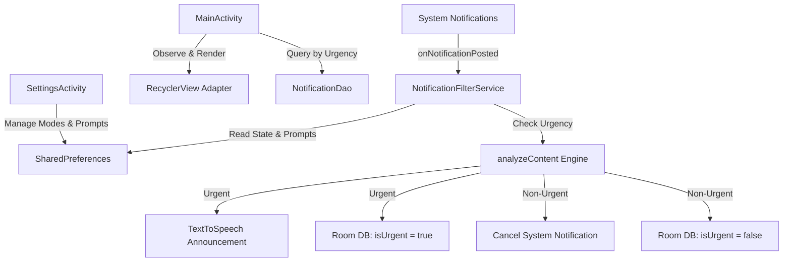

# FocusFlow - Technical Implementation Guide

This document provides a comprehensive technical breakdown of the architecture, data flows, core services, and persistence layers in **FocusFlow**.

---

## 1. Architecture & Component Interaction



---

## 2. Core Technical Components

### A. Background Notification Listening (`NotificationFilterService`)
- **Lifecycle**: Started as a bound system service when granted `BIND_NOTIFICATION_LISTENER_SERVICE` permission.
- **Processing Flow**:
  1. Intercepts `StatusBarNotification` via `onNotificationPosted(sbn)`.
  2. Ignores self-notifications and system UI notifications to prevent loops.
  3. Checks `service_running` in `SharedPreferences` (START/STOP master switch).
  4. Retrieves the active mode and evaluates its associated prompt (OOTB or custom) against notification `title` and `text`.
  5. **Urgent Route**: Speaks aloud via `TextToSpeech` (TTS) and persists to Room DB (`isUrgent = true`).
  6. **Muted Route**: Cancels the notification (`cancelNotification(sbn.key)`) and persists to Room DB (`isUrgent = false`).

### B. Local Persistence Layer (`Room Database`)
- **`NotificationEntity`**:
  ```kotlin
  @Entity(tableName = "notifications")
  data class NotificationEntity(
      @PrimaryKey(autoGenerate = true) val id: Int = 0,
      val title: String?,
      val text: String?,
      val packageName: String,
      val timestamp: Long,
      val isUrgent: Boolean = false // false = Muted, true = Shown (Urgent)
  )
  ```
- **`NotificationDao`**:
  - `getByUrgency(isUrgent: Boolean): List<NotificationEntity>` powers the Muted vs. Shown tab filtering in the UI.

### C. Dynamic Mode Management & Settings (`SettingsActivity`)
- **OOTB Mode Toggles**: Users can enable/disable Commute, Focus, and Reading modes, hiding unused modes from the home screen spinner.
- **Prompt Customization**: Users can edit system prompts for OOTB modes or create custom modes with dedicated rules.
- **Storage**: All configurations are persisted locally in `FocusFlowPrefs` (`SharedPreferences`).

### D. Hyper-Minimalist UI Design
- **Theme**: `Theme.Material3.DayNight.NoActionBar` ensuring native, crisp Light and Dark mode adaptation.
- **Layouts**: ConstraintLayout and RecyclerView with zero hardcoded shadows, flat styling, and generous whitespace.
- **Compatibility**: Targets `minSdk = 28` (Android 9.0 Pie) upwards, running smoothly on older and newer devices alike.

---

## 3. Git & GitHub CLI Workflow
- Managed via GitHub CLI (`gh`).
- Pushed on branch `feature/modern-ui-and-controls` under repository `gnanaswaroop/focusflow`.
