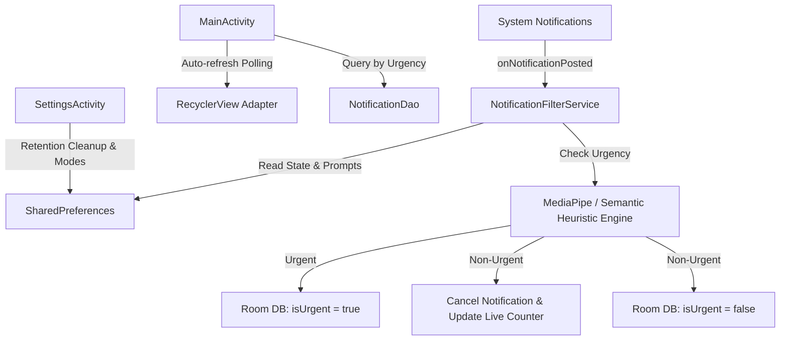

# FocusFlow - Technical Implementation Guide & Permission Reference

This document provides a comprehensive technical breakdown of the architecture, data flows, core services, persistence layers, and security permissions in **FocusFlow**.

---

## 1. Architecture & Component Interaction



---

## 2. Core Technical Components

### A. Background Notification Listening (`NotificationFilterService`)
- **Lifecycle**: Runs persistently in the background as an Android **Foreground Service** (`startForeground`) implementing `NotificationListenerService`.
- **Processing Flow**:
  1. Intercepts `StatusBarNotification` via `onNotificationPosted(sbn)`.
  2. Ignores self-notifications and system UI notifications.
  3. Checks `service_running` in `SharedPreferences`.
  4. Evaluates notification `title` and `text` against **MediaPipe Text Classification** (`text_classifier.tflite`) and **Semantic Heuristic Prompt Rules**.
  5. **Urgent Route**: Keeps the system notification visible and persists to Room DB (`isUrgent = true`).
  6. **Muted Route**: Cancels the system notification (`cancelNotification`), increments the live suppression counter, and persists to Room DB (`isUrgent = false`).
- **Live-Updating Status Bar Notification**: Provides an ongoing (`.setOngoing(true)`) foreground notification displaying the live suppression count (`"Suppressed: X notifications"`) and a **STOP/START** action button for quick status bar control.

### B. Local Persistence Layer (`Room Database`)
- **`NotificationEntity`**:
  ```kotlin
  @Entity(tableName = "notifications")
  data class NotificationEntity(
      @PrimaryKey(autoGenerate = true) val id: Int = 0,
      val title: String?,
      val text: String?,
      val packageName: String,
      val timestamp: Long,
      val isUrgent: Boolean = false
  )
  ```
- **`NotificationDao`**:
  - `getByUrgency(isUrgent: Boolean): List<NotificationEntity>` powers the Muted vs. Shown tab filtering.
  - `deleteOlderThan(cutoffTimestamp: Long)` powers automated data retention cleanup based on user settings.

### C. Dynamic Mode Management & Settings (`SettingsActivity`)
- **OOTB Modes**: **Commute** and **Do Not Disturb (DND)**, plus fully customizable **Custom Modes**.
- **Data Retention**: Configurable history retention in days (auto-cleans older records on save).
- **Theme Switcher**: In-app DayNight Material 3 theme switching (System Default, Light, Dark).

### D. Interactive UI & Auto-Refresh
- **Inbox Auto-Refresh**: Coroutine polling loop in `onResume` automatically refreshes Shown and Muted tabs in real-time.
- **Expandable Cards & Open App**: Tap to expand/collapse notification cards and launch target apps directly (with app-not-installed fallback).

---

## 3. Detailed Explanation of Android Permissions

FocusFlow strictly adheres to the principle of least privilege. Every permission declared in `AndroidManifest.xml` has a specific, transparent purpose:

1. **`android.permission.BIND_NOTIFICATION_LISTENER_SERVICE`**
   - **Purpose**: Essential core permission. Grants FocusFlow system-level access to listen to incoming notification events (`onNotificationPosted`) across applications so they can be evaluated and filtered in real-time.
2. **`android.permission.FOREGROUND_SERVICE`**
   - **Purpose**: Required by Android to run `NotificationFilterService` persistently in the background as a foreground service, ensuring filtering continues reliably when the app is minimized or closed.
3. **`android.permission.FOREGROUND_SERVICE_SPECIAL_USE`**
   - **Purpose**: Required on Android 14+ (API 34+) to justify the foreground service type (`specialUse`) for ongoing notification management and quick-control actions in the status bar.
4. **`android.permission.BLUETOOTH` & `android.permission.BLUETOOTH_CONNECT`**
   - **Purpose**: Used by `AutoActivationReceiver` to detect Bluetooth connections (e.g. connecting to car audio) for smart Commute mode auto-activation.
5. **`android.permission.ACCESS_FINE_LOCATION` & `android.permission.ACCESS_COARSE_LOCATION`**
   - **Purpose**: Optional location context permissions to assist with transit and commute detection triggers.

> **🔒 Privacy Guarantee**: FocusFlow declares **zero internet permissions**. All data processing, AI classification, and storage occur 100% locally on-device. No data ever leaves your device.
