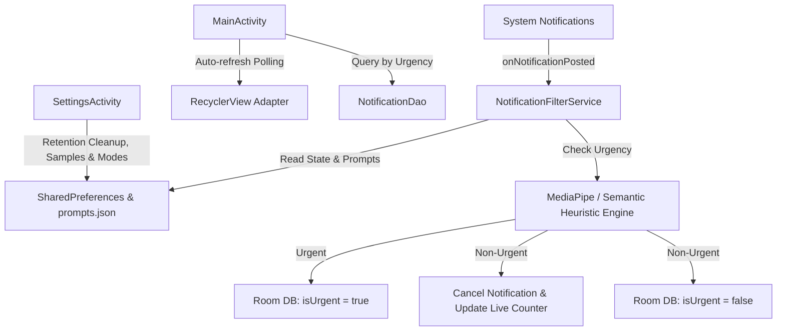

# FocusFlow - Technical Implementation Guide & Permission Reference

This document provides a comprehensive technical breakdown of the architecture, data flows, core services, persistence layers, and security permissions in **FocusFlow**.

---

## 1. Architecture & Component Interaction

---

## 2. Core Technical Components

### A. Background Notification Listening (`NotificationFilterService`)
- **Lifecycle**: Runs persistently in the background as an Android **Foreground Service** (`startForeground`) implementing `NotificationListenerService`.
- **Processing Flow**:
  1. Intercepts `StatusBarNotification` via `onNotificationPosted(sbn)`.
  2. Ignores self-notifications and system UI notifications.
  3. Checks `service_running` in `SharedPreferences`.
  4. Evaluates notification `title` and `text` against **MediaPipe Text Classification** (`text_classifier.tflite`) and **Semantic Heuristic Prompt Rules** (loaded via `PromptManager` from `assets/prompts.json`).
  5. **Urgent Route**: Keeps the system notification visible and persists to Room DB (`isUrgent = true`).
  6. **Muted Route**: Cancels the system notification (`cancelNotification`), increments the live suppression counter, and persists to Room DB (`isUrgent = false`).
- **Live Update Ongoing Notification**: Upgraded to comply with Android **Live Update / Ongoing Notification** specifications (`IMPORTANCE_DEFAULT`, `CATEGORY_SERVICE`, ongoing status). Displays a live-updating suppression count (`"Suppressed: X notifications"`) and a **STOP/START** action button. Stopping the service explicitly removes foreground status and cancels the live notification.

### B. Local Persistence Layer (`Room Database`)
- **`NotificationEntity`**: Stores notification metadata (`title`, `text`, `packageName`, `timestamp`, `isUrgent`).
- **`NotificationDao`**: Powers Muted vs. Shown tab filtering and automated data retention cleanup.

### C. Externalized OOTB Prompts (`PromptManager`)
- Out-of-the-box prompts are externalized into `assets/prompts.json` and loaded via `PromptManager`, allowing prompt tuning without recompiling or modifying Kotlin source code.

### D. Interactive UI & Dark-Mode First Design
- **Dark-Mode First**: Built with `Theme.MaterialComponents.DayNight` defaulting to `MODE_NIGHT_YES` with custom theme background attributes.
- **App Icons & Compact Actions**: Each inbox card displays the corresponding application icon and a clean external link icon button for launching target apps (with robust fallbacks for Telegram variants).

---

## 3. Detailed Explanation of Android Permissions

FocusFlow strictly adheres to the principle of least privilege:

1. **`android.permission.BIND_NOTIFICATION_LISTENER_SERVICE`**
   - **Purpose**: Essential core permission. Grants FocusFlow system-level access to listen to incoming notification events across applications.
2. **`android.permission.FOREGROUND_SERVICE` & `FOREGROUND_SERVICE_SPECIAL_USE`**
   - **Purpose**: Required to run `NotificationFilterService` persistently in the background as a foreground service with ongoing status.
3. **`android.permission.POST_NOTIFICATIONS`**
   - **Purpose**: Required on Android 13+ to post foreground service and status bar notifications.

> **🔒 Privacy Guarantee**: FocusFlow declares **zero internet permissions**. All data processing, AI classification, and storage occur 100% locally on-device.
