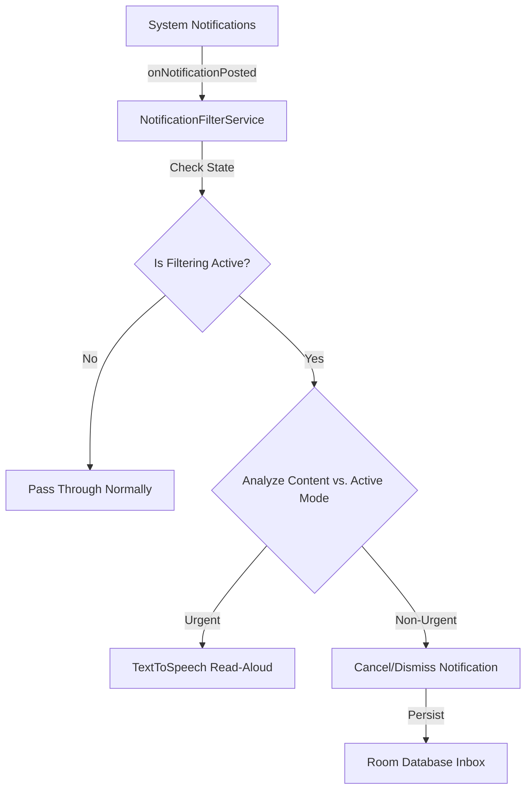

# Do I Care - Application Internals & Architecture

This document details the internal workings, data flows, and architectural components of the **Do I Care** application.

---

## 1. Core Architecture & Components

### Key Modules & Classes

1. **`NotificationFilterService` (`NotificationListenerService`)**:
   - Runs as a background system service requiring notification listener permissions.
   - Intercepts all incoming `StatusBarNotification` events.
   - Reads user preferences (`service_running` toggle and `current_mode`) from `SharedPreferences`.
   - Evaluates content urgency via `analyzeContent()`.
   - Cancels non-urgent clearable notifications and saves them to Room DB, or speaks urgent notifications via `TextToSpeech`.

2. **`MainActivity` (`AppCompatActivity`)**:
   - Manages the modern minimalist 2026 UI.
   - Automatically detects notification listener access status via `enabled_notification_listeners`.
   - Hides the "Enable Notification Access" button once permission is granted and displays a green checkmark status indicator.
   - Hosts the **START / STOP** master toggle (`switchFiltering`), persisting the run state in `SharedPreferences`.
   - Displays archived notifications from the Room database inbox in a `RecyclerView`.

3. **Room Database (`AppDatabase`, `NotificationEntity`, `NotificationDao`)**:
   - Provides local, offline persistence for archived notifications.
   - Asynchronous database queries executed via Kotlin coroutines (`Dispatchers.IO`).

---

## 2. Notification Filtering Logic

The filtering engine assesses notification titles and text against rules defined for the selected mode:
- **Commute Mode**: Matches keywords like `navigation`, `turn left`, `turn right`, `meeting`, `traffic`, `call`.
- **Focus Mode**: Matches keywords like `call`, `boss`, `emergency`.
- **Reading Mode**: Matches keywords like `emergency`, `hospital`.

---

## 3. Git Branching & Workflow

All enhancements and modern UI controls are developed on a dedicated feature branch (`feature/modern-ui-and-controls`) and managed via GitHub CLI (`gh`).
