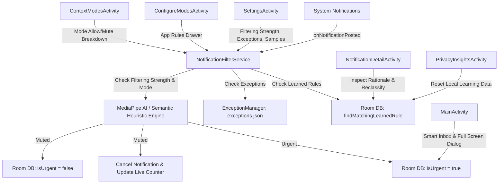

# FocusRefine — Technical Implementation Guide & Architecture

This document provides a comprehensive technical breakdown of the architecture, data flows, core services, persistence layers, and 16 KB memory page size alignment in **FocusRefine**.

---

## 1. Architecture & Component Interaction



---

## 2. Core Technical Components

### A. Background Notification Filtering (`NotificationFilterService`)
- **Lifecycle**: Persistent Android Foreground Service (`specialUse`) implementing `NotificationListenerService`.
- **Pipeline Order**:
  1. **User Learned Rules**: Checked via `database.notificationDao().findMatchingLearnedRule()`.
  2. **JSON-Driven Exceptions**: Evaluates user-enabled exception rules from `ExceptionManager.getAllExceptions(this)` (`assets/exceptions.json`).
  3. **MediaPipe AI Engine**: Evaluates `text_classifier.tflite` against the dynamic filtering strength threshold (`Gentle` = `0.4f`, `Balanced` = `0.6f`, `Strict` = `0.8f`).
  4. **Semantic Prompt Heuristic Engine**: Tokenizes content against active mode prompts (`PromptManager`).
- **Foreground Status Banner**: Displays real-time suppression count (`"Suppressed: X notifications"`) with a **STOP/START** action button.

### B. Dark Studio Design System & Reusable UI Components
- **`FocusRefineTheme`**: Defines `#0F0E17` dark background, `#181625` / `#201D33` elevated surfaces, `#8B5CF6` electric violet primary accents, `#22C55E` green active badges, and `#EF4444` muted tags.
- **`StudioCard`**: Rounded container (`20.dp` corners) defaulting to `Modifier.fillMaxWidth()` with `#352F52` borders.
- **`AppIconImage`**: Uses `LocalContext.current.packageManager.getApplicationIcon(packageName)` to render native application icons directly from installed Android package manifests.
- **`StudioSegmentedControl`**: Horizontal tri-state and multi-option pill selector.
- **`StudioFooter`**: Scroll-triggered footer embedded inside `LazyColumn` items or scrollable containers.

### C. 6 Primary Screen Activities
1. **`MainActivity.kt`**: Smart Inbox dashboard with stat card, context mode chips, search field, pill tabs (`Muted` / `Shown`), native app icon cards, full-screen inbox dialog (`⛶`), and scrollable footer.
2. **`SettingsActivity.kt`**: `Gemini Nano AI Active` banner, filtering strength selector (`Gentle` | `Balanced` | `Strict`), JSON-driven exception toggles, mode switcher, and sample seeding actions.
3. **`NotificationDetailActivity.kt`**: Notification inspection card, AI explanation card (*"Why it was muted"*), `Show notification` / `Keep muted` / `Open app` buttons, and feedback controls.
4. **`ConfigureModesActivity.kt`**: Searchable app rules list with expandable WhatsApp rule tuner drawer (`Use AI` | `Allow all` | `Mute all`).
5. **`ContextModesActivity.kt`**: Context modes hub showing active mode banner, cards for `Commute`, `Deep Focus`, `Sleep`, and `Gaming` with Allow/Mute rule breakdowns, and manual mode switcher.
6. **`PrivacyInsightsActivity.kt`**: On-Device protection status badge, daily filtering metrics card with dynamic `0% Noise Filtered` reset, and clear local learning data reset dialog.

### D. 16 KB Page Size Alignment (Android 15 Compatibility)
- Configured in `app/build.gradle.kts`:
  ```kotlin
  packaging {
      jniLibs {
          useLegacyPackaging = false
      }
  }
  ```
- Unsets `android:extractNativeLibs="true"` in `AndroidManifest.xml`, ensuring native JNI libraries (MediaPipe/TFLite) are aligned on 16 KB page boundaries in APK releases.

### E. Externalized Configuration Assets
- `assets/prompts.json`: Managed via `PromptManager.kt`.
- `assets/exceptions.json`: Managed via `ExceptionManager.kt`.
- `assets/samples.json`: 20 pre-configured test notifications for instant offline benchmarking and UI evaluation.
