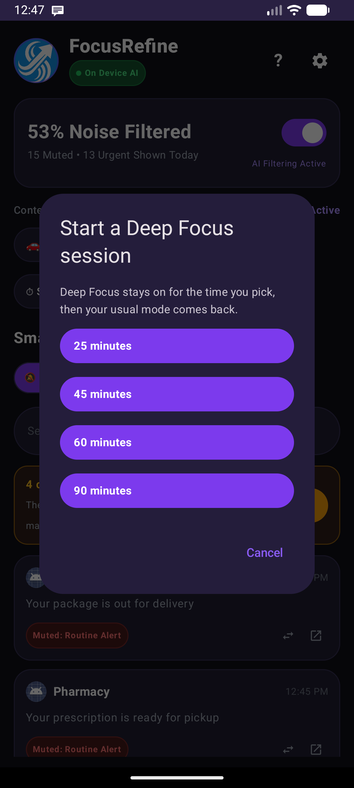
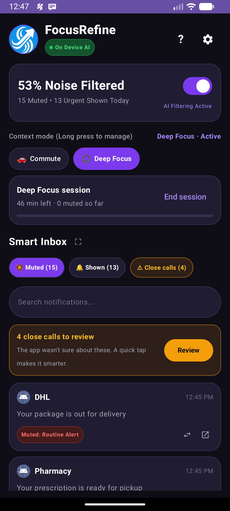
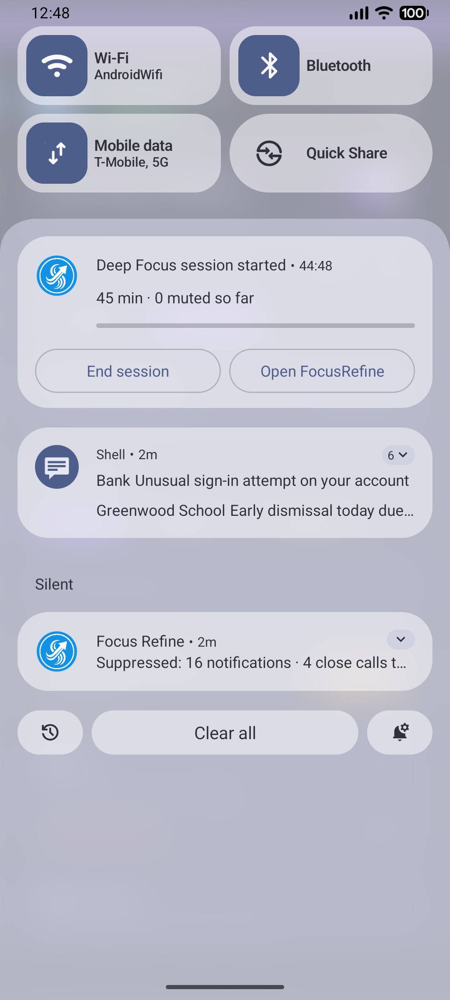

# Timed mode sessions

A session keeps one context mode on for a set time ("Deep Focus for 45 minutes") and then puts the previous mode back.

## Using it

| Pick a length | Running on Home | Live notification |
| --- | --- | --- |
|  |  |  |

- On Home, under the mode chips, tap **Start a timed session** and pick 25, 45, 60 or 90 minutes. The session uses the mode that is selected.
- While it runs, Home shows a card with the time left, how many notifications were muted during the session, a progress bar and **End session**.
- A **live notification** shows the same: title "Deep Focus session started" for the first minute, then "Deep Focus · 32 min left", a progress bar, a system countdown, and **End session** and **Open FocusRefine** buttons. On Android 16 it asks to be promoted to a Live Update (status bar chip) through `android.requestPromotedOngoing` and the `POST_PROMOTED_NOTIFICATIONS` permission; earlier versions show a normal ongoing notification.
- When time is up, or when you press End session, the previous mode returns. A finished session also posts one "session complete" note with the muted count.

## How it works

`ModeSession` keeps the state in the preferences (`session_mode`, `session_start`, `session_end`, `session_previous_mode`, `session_base_count`), so it survives the app process being killed. A once-a-minute inexact alarm (`ModeSessionReceiver`) refreshes the notification and finishes the session on time; no exact-alarm permission is needed, and a minute of slack is fine for a countdown. The listener service also refreshes the notification when it mutes something, so the count stays current. Starting a second session keeps the original mode to go back to. Nothing uses the network.

## Tests

`ModeSessionTest` (JVM: progress, minutes left, phase), `ModeSessionE2ETest` (device: start, active, end, complete, second session, and the Home buttons).

## Not done

A mockup-style Android 16 `ProgressStyle` with segments and points needs compileSdk 36; the app is on 34, so it uses the standard progress bar and chronometer.
